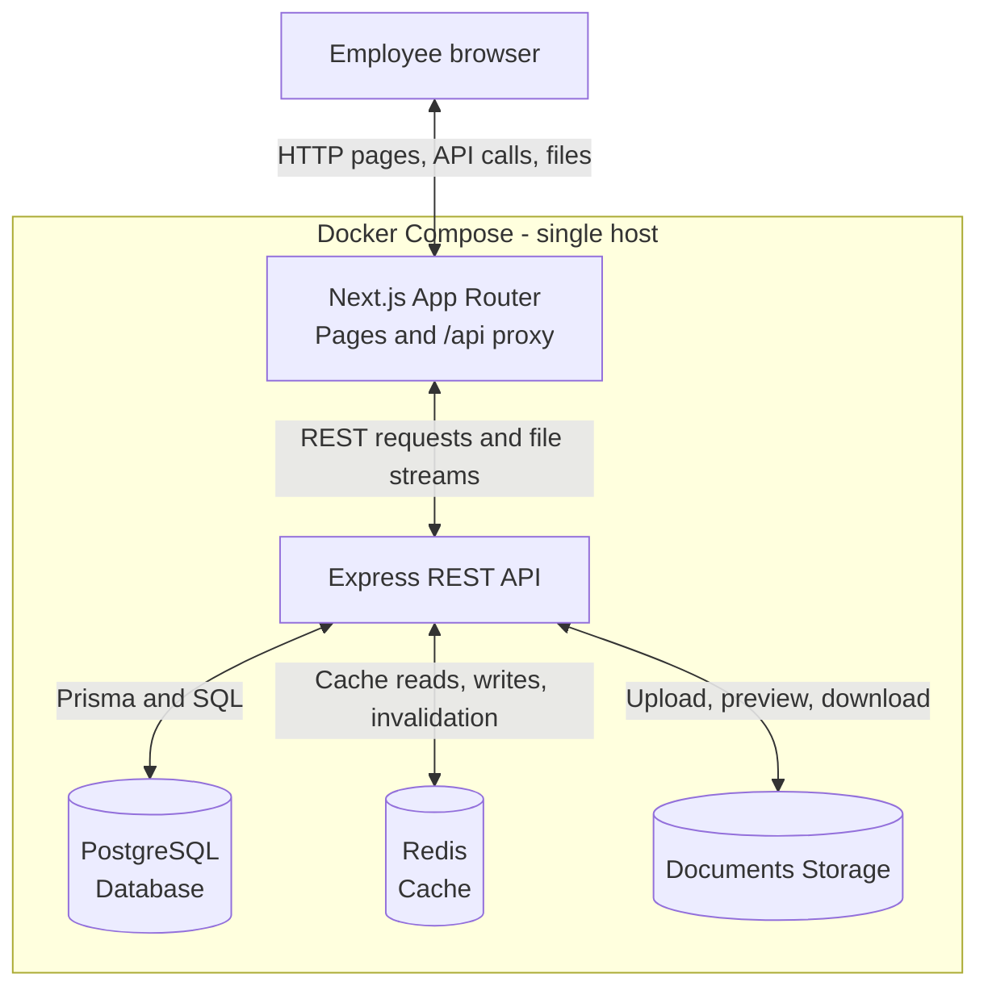
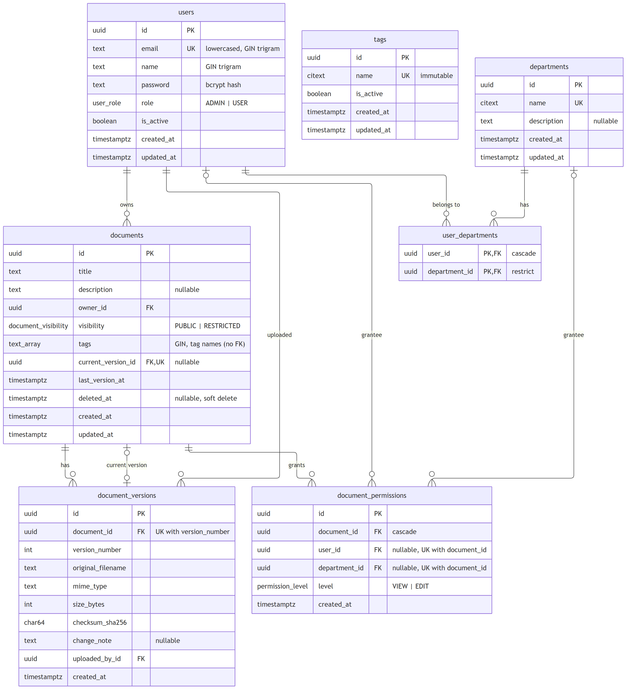

# System architecture

The browser sends its session cookie with API requests.
The API checks document access before it returns metadata or file content.
PostgreSQL is the source of truth. Redis holds disposable cache data.
The `pgdata` and `uploads` volumes retain data after the containers stop.

## Design choices

The browser uses one origin for pages and API calls.
Next.js forwards `/api` requests to Express through the internal Docker network.
The API validates input with Zod and checks access before it returns a document or file.
Routes, controllers, services, and models separate HTTP, business rules, and database access.
Services start transactions for changes that affect multiple tables.

PostgreSQL stores users, departments, documents, versions, and access grants.
Prisma defines the relations and generates UUIDv7 identifiers.
The migration adds `citext`, `pg_trgm`, and a constraint for each grant target.
Documents store tag names in a PostgreSQL array with a GIN index.
A separate tag catalog supplies default choices without a foreign key from each document tag.

Each document points to its current version.
Each version records the filename, MIME type, size, checksum, uploader, and optional change note.
The upload volume stores each file at `<documentId>/<versionNumber>`.
A new version changes the current pointer and retains the old file.
A database transaction and file cleanup handle ordinary upload failures.
They do not provide an atomic transaction across PostgreSQL and the filesystem after a process
crash.

Redis caches search results for one hour and other cached data for three hours.
Successful changes invalidate related cache groups.
Document search keys include the user ID because access differs between users.
The health endpoint reports a degraded state if Redis fails and PostgreSQL remains available.

This is a single-host POC, not a measured production deployment.
Shared object storage, search indexes, and load measurements are next steps for scale.
A GIN trigram index supports document title search. An owner ID index supports the uploader filter.
Description and filename search still lack dedicated indexes.

## Database relations

The schema is in [Prisma schema](../backend/prisma/schema.prisma).
The initial migration includes constraints that the Prisma schema cannot express.

Each grant targets exactly one user or department.
The `currentVersionId` relation selects one version from the document history.
The tag catalog has no relation to the document tag array.
Refer to [DESIGN.md](../DESIGN.md) for the interface rules.

