# UI direction B: EEMW command CRM

Direction B makes EEMW Documents look like a calm CRM console. An ink sidebar holds the brand and
the navigation. The work area is paper, with white panels and dense tables.

The shared rules are in `docs/ui-redesign-rules.md`. The visual system is in `DESIGN.md`.

## Run the stack

1. Copy `.env` from the main checkout into the worktree root.
2. In PowerShell, set the B ports:
   `$env:FRONTEND_PORT=3002; $env:BACKEND_PORT=4002; $env:POSTGRES_PORT=5434;`
   `$env:REDIS_PORT=6381; $env:STUDIO_PORT=5557`
3. Start the stack: `docker compose -p docrepo-b up --build -d`.
4. Seed the database: `docker compose -p docrepo-b exec backend npm run db:seed`.
5. Open http://localhost:3002 and log in as `admin@docrepo.local` with the seed password.

CAUTION: Do not use the project name `document-repository`. The seed deletes all the data of that
stack.

## Design

- **Sidebar:** The sidebar is ink `#0F172A` and is the only dark surface. It holds the EEMW logo,
  "EEMW Documents", the Documents and Settings links, and the account menu. The selected link has a
  deep navy `#1A2744` fill and a teal `#14B8A6` mark.
- **Work area:** The ground is paper `#F8F7F4`. Content is in white panels with `#E7E5E0` borders
  and a 12px radius.
- **Tables:** Rows are 40px high. The header stays at the top when the table scrolls. Sizes, dates
  and counts use tabular numbers. File types and tags show as chips.
- **Controls:** Buttons, filter triggers and search fields are pills. The primary button is teal
  dark `#0F766E` with white text. Text fields have an 8px radius.
- **Type:** Page titles use Space Grotesk. All other text uses Inter.
- **Color:** Teal shows the main action, the selected item and the focus. Amber `#F59E0B` shows
  warnings only, for example an old version of a document.

## Screens

### Documents list

On desktop, the table panel fills the page height. The table scrolls inside the panel, so the
filters and the pagination stay in view.

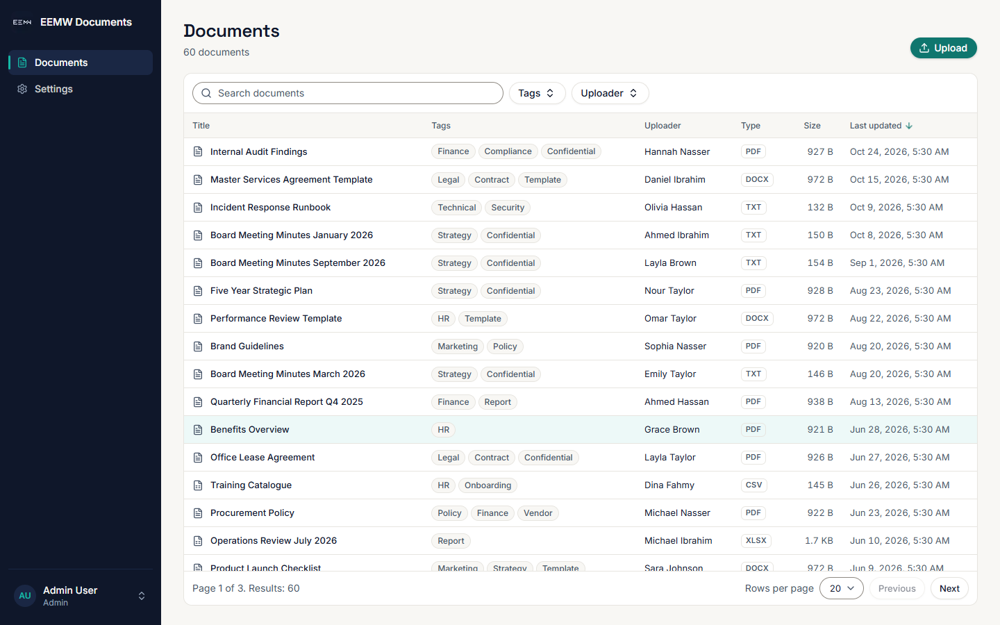

### Document detail

The preview is on the left. The Details and Access panels are on the right. Access shows the
visibility, the viewers and the editors. The version history is below the preview.

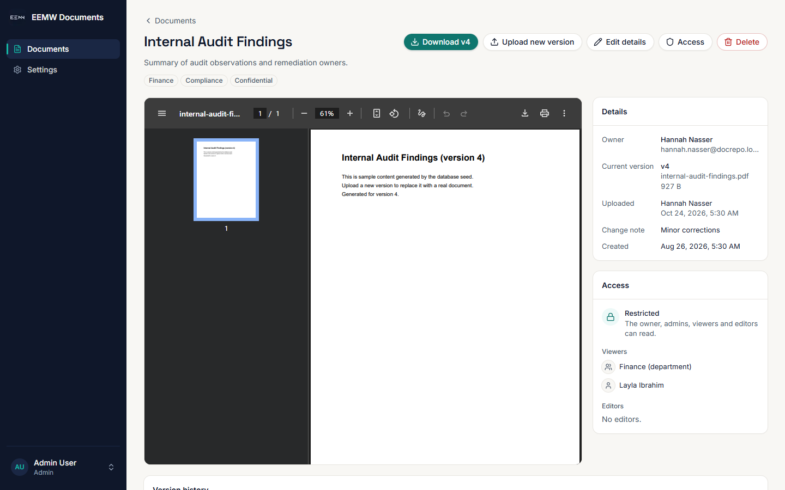

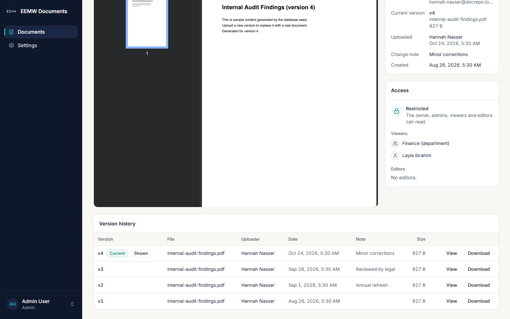

### Dialogs

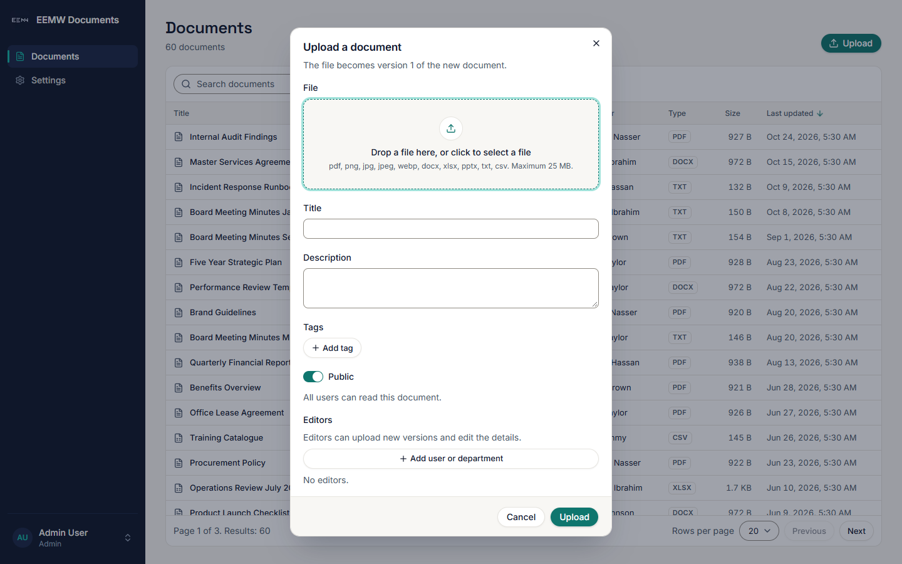

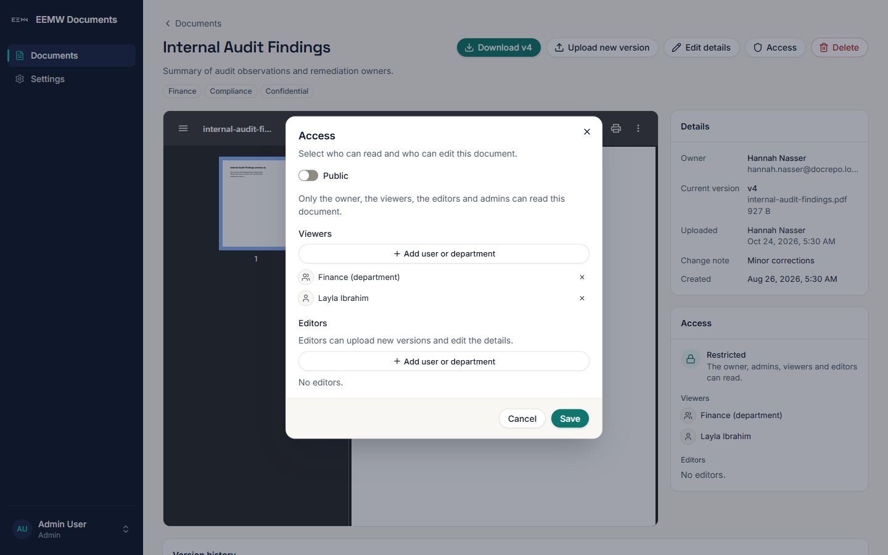

### Settings

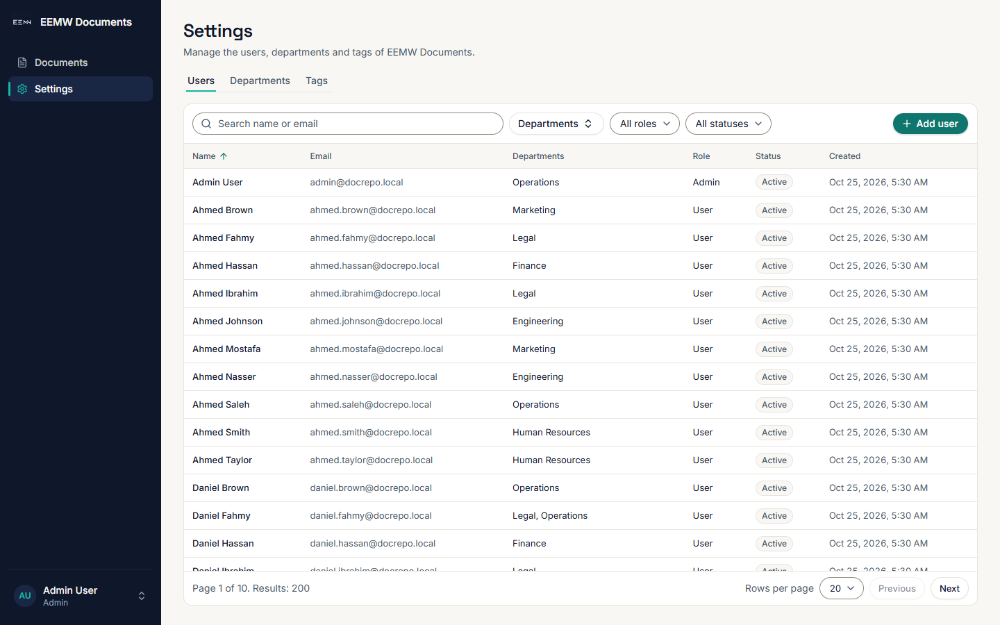

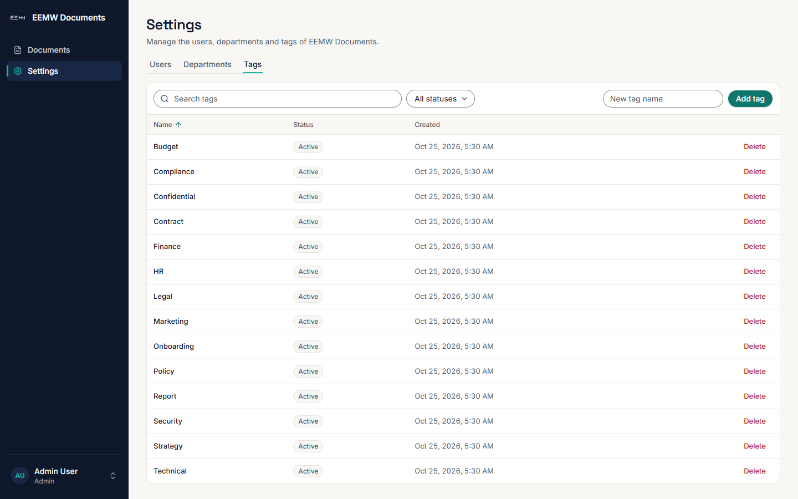

### Login

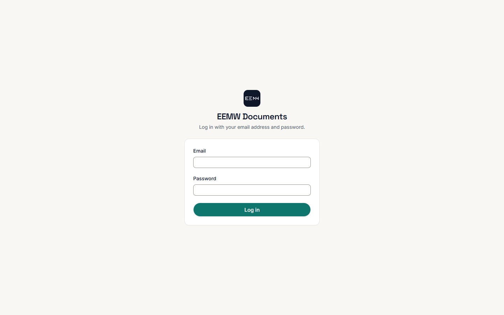

### Phone width (390px)

On phone width, the sidebar folds into a menu button in an ink top bar. The menu button opens the
sidebar from the left. The pages have no horizontal scroll. Wide tables scroll inside their panel.

| Documents | Menu | Detail |
|---|---|---|
| 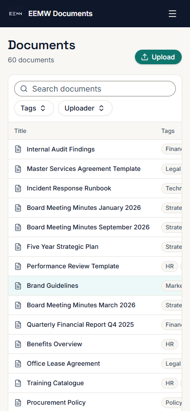 | 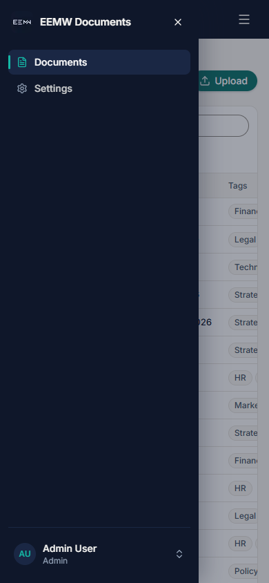 | 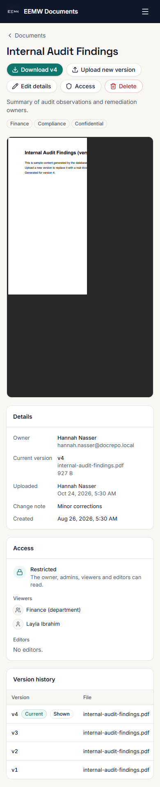 |

| Upload | Settings |
|---|---|
| 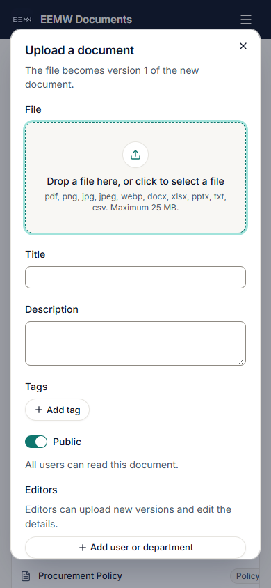 | 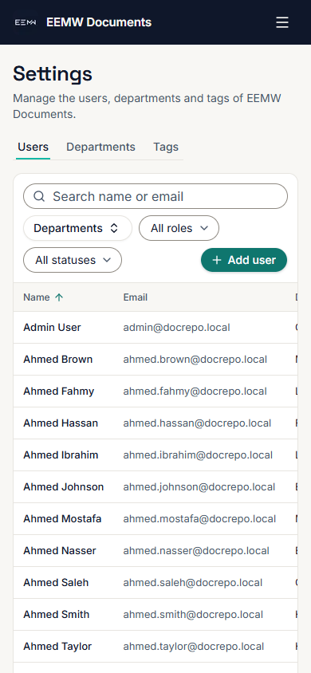 |

## Checks

- `npm run lint` and `npm run typecheck` pass in `frontend/`.
- All screens were examined at 1440px and 390px. No page has horizontal scroll at 390px.

## Known limits

- The focus ring is teal `#14B8A6`, as the shared rules specify. Its contrast on white is 2.5:1.
  Text fields also get a teal dark `#0F766E` border on focus.
- The palette has no red. Errors and the Delete action use `#B91C1C` (6.5:1 on white).
- The border of text fields is `#8F8A82` (3.4:1 on white), so that the fields meet WCAG 1.4.11.
- `docs/ui-test-report.md` is not in this branch, so the defects D1, D2 and D3 were not examined.
